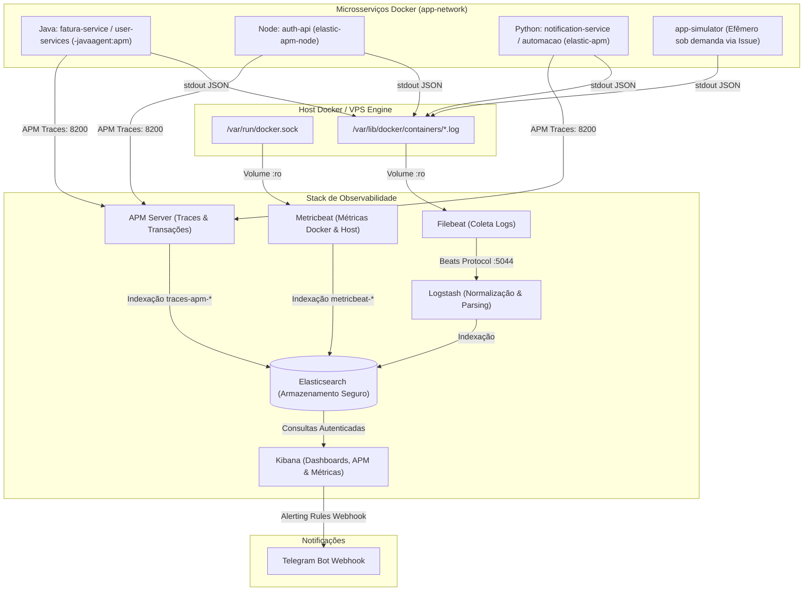

# 📊 Observability Stack - Elastic Stack (ELK / EFK + APM + Metricbeat)

[](https://github.com/sirondba/observability/actions/workflows/deployment-ci.yml)
[](https://github.com/sirondba/observability/actions/workflows/release.yml)
[](https://github.com/sirondba/observability/actions/workflows/workflow-main.yml)

Repositório central de infraestrutura e observabilidade corporativa baseado no **Elastic Stack (Elasticsearch, Kibana, Logstash, Filebeat, Metricbeat, APM Server)** com:
- **Centralização Estruturada de Logs:** Ingestão automática via Filebeat e enriquecimento no Logstash com normalização para `service.keyword`.
- **Métricas de Containers Docker:** Coleta em tempo real de uso de CPU, Memória, Disco I/O e Rede de cada container via Metricbeat integrado.
- **Application Performance Monitoring (APM):** Rastreabilidade distribuída (Distributed Tracing), latência de endpoints e chamadas de microsserviços via APM Server (porta 8200).
- **Autenticação e Segurança (X-Pack):** Acesso protegido por usuário/senha no Kibana e Elasticsearch, e chaves de criptografia configuradas para habilitar Alerting & Connectors.
- **Alertas no Telegram:** Regras de monitoramento proativo enviando alertas formatados diretamente para o Telegram.
- **Simulador Efêmero Sob Demanda:** Injeção de logs e cenários de teste via **Issue Form do GitHub** sem desperdiçar recursos da VPS 24/7.
- **CI/CD Automatizado:** Pipeline via **GitHub Actions** seguindo o padrão oficial dos microsserviços.

---

## 🏛 Arquitetura Completa da Stack



---

## 🔐 Segurança e Autenticação

A stack roda com a segurança básica ativada (`xpack.security.enabled=true`).

- **Acesso ao Kibana (Web UI):** Faça login na interface web (`http://<IP_VPS>:5601`) com:
  - **Usuário:** `elastic` (Superuser)
  - **Senha:** `elastic123` (ou o valor definido no secret `ELASTIC_PASSWORD` no GitHub)
- **Comunicação Interna do Kibana:** O Kibana se conecta ao Elasticsearch através do usuário de serviço interno `kibana_system`, cuja senha é provisionada automaticamente pelo container `elasticsearch-setup`.
- **Kibana Encryption Keys:** Chaves de 32+ caracteres já pré-configuradas (`XPACK_ENCRYPTEDSAVEDOBJECTS_ENCRYPTIONKEY`, `XPACK_REPORTING_ENCRYPTIONKEY`, `XPACK_SECURITY_ENCRYPTIONKEY`), liberando a funcionalidade de **Alerting e Criação de Connectors** (como o Webhook do Telegram).

---

## 🐳 Métricas dos Containers Docker (Metricbeat)

O Metricbeat já está incluído na stack e montado diretamente no `/var/run/docker.sock` do host. Ele coleta a cada 10 segundos:
- Consumo percentual de **CPU** por container.
- Consumo real e limite de **Memória RAM**.
- Operações de leitura/escrita em **Disco (I/O)**.
- Tráfego de entrada e saída de **Rede**.
- Estado de saúde (`healthcheck`) e status de execução de cada container.

### Como Visualizar no Kibana:
1. Acesse o Kibana no menu lateral: **Observability > Infrastructure > Inventory**.
2. Alterne a visualização para **Docker Containers**.
3. Ou acesse a tela do tutorial nativo: `http://<IP_VPS>:5601/app/home#/tutorial/dockerMetrics`.
4. Todos os containers da VPS aparecerão agrupados visualmente com barras de uso de CPU e Memória.

---

## ⚡️ Application Performance Monitoring (APM)

O **APM Server** está disponível na porta **`8200`** e conectado na mesma rede `app-network`. Ele permite visualizar:
- Tempo de resposta detalhado (latência) de cada endpoint HTTP.
- Gargalos em consultas de banco de dados SQL/NoSQL.
- Rastreamento distribuído de requisições entre microsserviços.

### Como Conectar suas Aplicações:

#### 1. Aplicações Java (Spring Boot / Micronaut - ex: `fatura-service`, `caderneta-user-services`)
Adicione o Elastic APM Java Agent no Dockerfile ou variáveis de ambiente do container:
```dockerfile
# Baixar o agente oficial no Dockerfile
ADD https://repo1.maven.org/maven2/co/elastic/apm/elastic-apm-agent/1.49.0/elastic-apm-agent-1.49.0.jar /app/elastic-apm-agent.jar
```
No `docker-compose.yml` da aplicação:
```yaml
environment:
  - JAVA_TOOL_OPTIONS=-javaagent:/app/elastic-apm-agent.jar
  - ELASTIC_APM_SERVICE_NAME=fatura-service
  - ELASTIC_APM_SERVER_URL=http://apm-server:8200
  - ELASTIC_APM_ENVIRONMENT=production
  - ELASTIC_APM_APPLICATION_PACKAGES=com.azevedo
```

#### 2. Aplicações Python (FastAPI / Flask - ex: `notification-service`, `automacao-resgate-fatura`)
Instale o pacote:
```bash
pip install elastic-apm
```
No código ou variáveis de ambiente:
```yaml
environment:
  - ELASTIC_APM_SERVICE_NAME=notification-service
  - ELASTIC_APM_SERVER_URL=http://apm-server:8200
  - ELASTIC_APM_ENVIRONMENT=production
```
No FastAPI/Flask:
```python
from elasticapm.contrib.starlette import ElasticAPM
app.add_middleware(ElasticAPM, client=client)
```

#### 3. Aplicações Node.js (Express / NestJS - ex: `auth-api`)
Instale o pacote:
```bash
npm install elastic-apm-node --save
```
Na **primeira linha** do arquivo principal (`index.js` ou `server.js`):
```javascript
const apm = require('elastic-apm-node').start({
  serviceName: 'auth-api',
  serverUrl: 'http://apm-server:8200',
  environment: 'production'
});
```

---

## 🧪 Simulador de Logs e Carga Sob Demanda (Via Issue)

Para **não consumir memória e CPU na VPS desnecessariamente**, o container simulador `app-simulator` **NÃO** roda 24/7. Ele utiliza o recurso `profiles: ["simulator"]` do Docker Compose.

### Como Disparar Testes de Simulação:
1. Vá até a aba **Issues** do repositório no GitHub.
2. Clique em **New Issue** e escolha o template:
   **`🧪 Simulação de Logs & Testes (Sob Demanda)`**.
3. Selecione os parâmetros desejados:
   - **Cenário:** `normal` (baseline), `burst` (stress/alta taxa), `error-spike` (rajada de erros 500 para validar Telegram) ou `all`.
   - **Microsserviço:** Escolha um serviço específico ou `todos`.
   - **Duração:** Tempo em segundos (ex: `60`).
   - **Taxa:** Quantidade de logs/s (ex: `5`).
4. Clique em **Submit new issue**.
5. O workflow GitHub Actions `.github/workflows/simulate-logs.yml` irá:
   - Iniciar o container efêmero na VPS na rede `app-network`.
   - Injetar os logs que serão ingeridos pelo Filebeat e Logstash em tempo real.
   - Encerrar e remover o container automaticamente ao fim do teste (`--rm`).
   - Comentar o resultado e fechar a Issue automaticamente.

---

## 📁 Estrutura do Repositório

```text
.
├── .github/
│   ├── ISSUE_TEMPLATE/
│   │   └── simular-logs.yml       # Formulário de simulação de carga sob demanda
│   └── workflows/
│       ├── deployment-ci.yml      # CI: Lint, validações e abertura de PR para release
│       ├── release.yml            # Release: Validações e abertura de PR para main
│       ├── workflow-main.yml      # Gatilho de deploy automático em push na main
│       ├── execute-deploy.yml     # Workflow oficial de deploy na VPS com SSH/SCP
│       ├── rollback-deploy.yml    # Rollback automatizado de versões
│       └── simulate-logs.yml      # Execução sob demanda do simulador efêmero na VPS
├── config/
│   ├── apm-server/
│   │   └── apm-server.yml         # Configuração do APM Server
│   ├── elasticsearch/
│   │   ├── ilm-policy.json        # Política de ciclo de vida de índices (ILM)
│   │   └── index-template.json    # Composable Index Template nativo
│   ├── filebeat/
│   │   └── filebeat.yml           # Autodiscover de containers e envio ao Logstash
│   ├── kibana/
│   │   └── alerts/
│   │       ├── README.md          # Guia de configuração de alertas no Telegram
│   │       └── telegram_webhook_payload.json # Payload padrão para Webhook Telegram
│   ├── logstash/
│   │   ├── logstash.conf          # Pipeline de parsing de JSON e enriquecimento de logs
│   │   └── logstash.yml           # Tuning de performance (workers, host HTTP)
│   └── metricbeat/
│       └── metricbeat.yml         # Coleta de métricas Docker (CPU, Memória, I/O, Rede)
├── docs/
│   ├── GUIA_TECNICO.md            # Documentação técnica detalhada
│   ├── PLANO_ESTRUTURACAO_LOGS.md # Plano de transição das aplicações para JSON nativo
│   └── guia-tecnico-elastic-stack.pdf
├── infra/
│   ├── dev/
│   │   └── config.json            # Configuração do ambiente de desenvolvimento
│   └── prod/
│       └── config.json            # Configuração oficial de produção
├── scripts/
│   ├── run_scenarios.sh           # Script local interativo de testes
│   ├── setup_vps.sh               # Script de preparação inicial do host VPS
│   └── simulate_logs.py           # Gerador sintético de logs corporativos em Python
├── .env.example                   # Template completo de variáveis de ambiente
├── docker-compose.yml             # Manifesto oficial da stack
└── README.md                      # Documentação central do projeto
```

---

## ⚙️ Pré-requisitos e Setup Único na VPS

Execute uma única vez no servidor caso ainda não tenha ajustado o parâmetro de memória do kernel:

```bash
# Ajustar vm.max_map_count (mínimo de 262144 exigido pelo Elasticsearch)
sudo sysctl -w vm.max_map_count=262144
echo "vm.max_map_count=262144" | sudo tee /etc/sysctl.d/99-elasticsearch.conf
sudo sysctl --system
```

> 💡 **Nota:** O script [`scripts/setup_vps.sh`](scripts/setup_vps.sh) automatiza esta etapa caso deseje executá-lo diretamente na VPS.

---

## 🔑 Segredos a Configurar no GitHub (`Settings > Secrets and variables > Actions`)

| Secret | Obrigatório? | Descrição |
| :--- | :---: | :--- |
| `GH_TOKEN` | **Sim** | Personal Access Token com permissão de `repo` para PRs automáticos |
| `VPS_HOST` | **Sim** | IP público ou domínio da VPS |
| `VPS_USERNAME` | **Sim** | Usuário SSH do servidor (ex: `ubuntu` ou `root`) |
| `VPS_SSH_PRIVATE_KEY` | **Sim** | Chave privada SSH autorizada |
| `APP_SECRETS` | *(Recomendado)* | JSON com credenciais do Telegram e senhas personalizadas |

Exemplo completo de `APP_SECRETS`:
```json
{
  "ELASTIC_PASSWORD": "sua_senha_super_segura",
  "KIBANA_ENCRYPTION_KEY": "uma_chave_secreta_com_mais_de_32_caracteres_12345",
  "TELEGRAM_BOT_TOKEN": "123456789:ABCdefGHIjklMNOpqrSTUvwxYZ",
  "TELEGRAM_CHAT_ID": "-1001234567890"
}
```
*(Caso não informe `ELASTIC_PASSWORD` ou `KIBANA_ENCRYPTION_KEY`, a stack utilizará com segurança os defaults protegidos predefinidos).*

---

## 🔔 Configuração de Alertas no Telegram

Com as chaves de criptografia configuradas, a tela de criação de conectores do Kibana fica 100% liberada:
1. No Kibana, vá em **Stack Management > Connectors > Create connector**.
2. Selecione **Webhook** e aponte para `https://api.telegram.org/bot<TOKEN>/sendMessage`.
3. Siga o passo a passo com o payload JSON pronto em [`config/kibana/alerts/README.md`](config/kibana/alerts/README.md).
