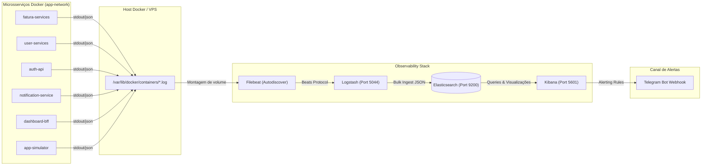

# 📊 Observability Stack - Elastic Stack (ELK / EFK)

[](https://github.com/sirondba/observability/actions/workflows/ci.yml)
[](https://github.com/sirondba/observability/actions/workflows/workflow-main.yml)

Repositório central de infraestrutura e observabilidade baseado no **Elastic Stack (Elasticsearch, Kibana, Logstash, Filebeat)** com ingestão estruturada de logs, dashboards operacionais dinâmicos (`service.keyword`), regras de alerta integradas via **Telegram Bot** e pipeline de deploy contínuo via **GitHub Actions** na VPS.

---

## 🏛 Arquitetura do Pipeline de Logs



---

## 📁 Estrutura do Repositório

```text
.
├── .github/
│   └── workflows/
│       ├── ci.yml                 # Lint e validação de compose, JSONs e scripts
│       ├── execute-deploy.yml     # Workflow reutilizável de deploy na VPS com SSH/SCP
│       └── workflow-main.yml      # Gatilho de deploy automático em push na branch main
├── config/
│   ├── elasticsearch/
│   │   ├── ilm-policy.json        # Política de ciclo de vida de índices (Hot/Warm/Cold/Delete)
│   │   └── index-template.json    # Template com mapeamento para service.keyword
│   ├── filebeat/
│   │   └── filebeat.yml           # Autodiscover de containers e envio para o Logstash
│   ├── kibana/
│   │   └── alerts/
│   │       ├── README.md          # Guia de configuração de alertas no Telegram
│   │       └── telegram_webhook_payload.json # Payload padrão para Webhook Telegram
│   └── logstash/
│       ├── logstash.conf          # Pipeline de parsing de JSON e enriquecimento de logs
│       └── logstash.yml           # Tuning de performance (workers, batch size, fila)
├── docs/
│   ├── GUIA_TECNICO.md            # Documentação técnica detalhada (ILM, Tuning, Autodiscover)
│   ├── PLANO_ESTRUTURACAO_LOGS.md # Plano de estruturação gradual dos logs das aplicações
│   └── guia-tecnico-elastic-stack.pdf # Arquivo original da arquitetura técnica
├── infra/
│   ├── dev/
│   │   └── config.json            # Configuração do ambiente de desenvolvimento
│   └── prod/
│       └── config.json            # Configuração oficial de produção (padrão dos microsserviços)
├── scripts/
│   ├── run_scenarios.sh           # Menu interativo para simulação de cenários de carga
│   ├── setup_vps.sh               # Script de preparação inicial do host VPS
│   └── simulate_logs.py           # Gerador de logs sintéticos estruturados em Python
├── .env.example                   # Template de variáveis de ambiente com documentação
├── .gitignore                     # Arquivos ignorados pelo Git
├── docker-compose.yml             # Manifesto Docker Compose oficial da stack
└── README.md                      # Documentação central do projeto
```

---

## ⚙️ Configuração e Pré-requisitos na VPS

A stack se integra diretamente com a rede padrão **`app-network`** já utilizada pelos microsserviços na VPS.

### Pré-requisito do Kernel:
O kernel do Linux necessita do ajuste de mapa de memória exigido pelo Elasticsearch:

```bash
# Ajustar vm.max_map_count (mínimo de 262144 exigido pelo Elasticsearch)
sudo sysctl -w vm.max_map_count=262144
echo "vm.max_map_count=262144" | sudo tee /etc/sysctl.d/99-elasticsearch.conf
sudo sysctl --system
```

> 💡 **Nota:** Caso execute [`scripts/setup_vps.sh`](scripts/setup_vps.sh), o script valida se a rede `app-network` já existe e aplica a persistência do `vm.max_map_count`.

---

## 🚀 Como Executar Localmente

1. **Copiar o arquivo de variáveis de ambiente:**
   ```bash
   cp .env.example .env
   ```

2. **Garantir que a rede externa `app-network` exista localmente:**
   ```bash
   docker network create app-network || true
   ```

3. **Subir a stack via Docker Compose:**
   ```bash
   docker compose up -d
   ```

4. **Acessar os painéis:**
   - **Kibana:** [http://localhost:5601](http://localhost:5601)
   - **Elasticsearch API:** [http://localhost:9200](http://localhost:9200)
   - **Logstash Ingest:** `localhost:5044`

---

## 🔄 Pipeline CI/CD e Deploy na VPS

O deploy é 100% automatizado via **GitHub Actions**, seguindo o mesmo padrão dos microsserviços (`fatura-service`, `user-services`, `auth-api`):

### Workflows Disponíveis
- **`[CI] - Lint & Validation`**: Disparado em pull requests e branches `feature/**`. Valida a sintaxe do `docker-compose.yml`, esquemas JSON e scripts em Python/Shell.
- **`[PROD] - Observability Deploy`**: Disparado automaticamente ao mesclar código na branch `main` ou manualmente via `workflow_dispatch`.
- **`Observability Stack Deploy`**: Workflow reutilizável (`execute-deploy.yml`) que:
  1. Lê os parâmetros de `infra/prod/config.json`.
  2. Substitui referências de segredos (`SECRET::...`) a partir do secret `APP_SECRETS`.
  3. Transfere os manifests e arquivos de configuração para `/opt/observability` na VPS via SCP (`appleboy/scp-action`).
  4. Executa na VPS: `docker compose pull`, `docker compose up -d` e bateria de health checks no Elasticsearch e Kibana via SSH (`appleboy/ssh-action`).

### Secrets a Configurar no GitHub (`Settings > Secrets and variables > Actions`)

| Secret | Obrigatório? | Descrição |
| :--- | :---: | :--- |
| `VPS_HOST` | **Sim** | IP público ou domínio da sua VPS |
| `VPS_USERNAME` | **Sim** | Usuário SSH do servidor (ex: `root` ou `ubuntu`) |
| `VPS_SSH_PRIVATE_KEY` | **Sim** | Chave privada SSH autorizada na VPS |
| `APP_SECRETS` | *(Recomendado)* | JSON com as credenciais do Telegram: |

Exemplo de conteúdo do secret `APP_SECRETS`:
```json
{
  "TELEGRAM_BOT_TOKEN": "123456789:ABCdefGHIjklMNOpqrSTUvwxYZ",
  "TELEGRAM_CHAT_ID": "-1001234567890"
}
```

---

## 🧪 Testes de Carga e Simulação de Logs

Para testar o fluxo de ingestão e validar se os alertas no Telegram estão disparando corretamente, utilize os scripts inclusos na pasta `scripts/`:

```bash
# Executar menu interativo de testes
./scripts/run_scenarios.sh

# Ou acionar cenários específicos via linha de comando:
./scripts/run_scenarios.sh normal       # 2 logs/s (Baseline normal)
./scripts/run_scenarios.sh burst        # 50 logs/s (Stress de throughput)
./scripts/run_scenarios.sh error-spike  # 15 logs/s com códigos 5xx e stacktraces
```

---

## 🔔 Configuração de Alertas no Telegram

As instruções completas para conectar o Kibana ao Telegram Bot com o template de payload pré-configurado estão disponíveis em [`config/kibana/alerts/README.md`](config/kibana/alerts/README.md).

---

## 📚 Documentação Técnica Adicional

- [`docs/PLANO_ESTRUTURACAO_LOGS.md`](docs/PLANO_ESTRUTURACAO_LOGS.md): Plano de transição das aplicações para JSON nativo.
- [`docs/GUIA_TECNICO.md`](docs/GUIA_TECNICO.md): Autodiscover com hints, políticas de retenção (ILM) e tuning de JVM.
